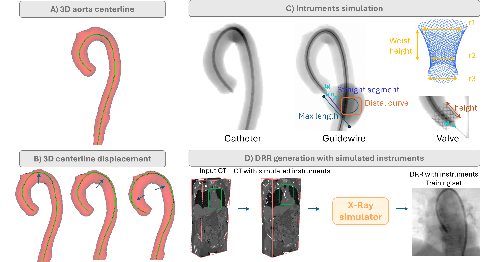
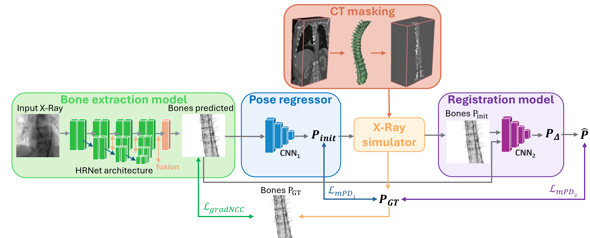
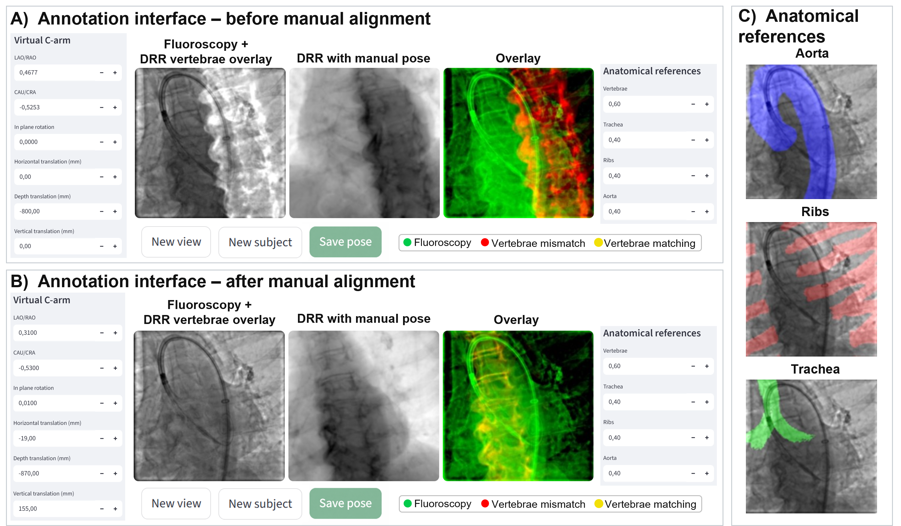

# FluoroPose: CT-to-Fluoroscopy Real-Time Registration 

Learning-based 3D/2D registration of a preoperative CT to intraoperative X-Ray fluoroscopy.

---

## Overview

### 1. TAVI: DRR generation with simulated instruments



Training data are synthesized from a CT volume in four steps:

- **A) 3D aorta centerline.** The centerline is extracted from the segmented aorta.
- **B) 3D centerline displacement.** The centerline is displaced in 3D to vary the instrument trajectory inside the vessel.
- **C) Instruments simulation.** Instruments are generated parametrically along the centerline.
- **D) DRR generation.** The simulated instruments are inserted into the CT volume, and the X-ray simulator renders a DRR with instruments, which goes into the training set.

### 2. FluoroPose pipeline



- **BonesHRNet.** An HRNet-based network predicts a bones representation image from the input X-ray, trained with a gradient-NCC loss (`L_gradNCC`) against the bone DRR.
- **Pose regressor.** Regresses an initial pose `P_init` from the predicted bone representation image, trained with a mean projection distance loss (`L_mPD₁`) against `P_GT`.
- **Registration model.** Takes the predicted bones and the DRR at `P_init`, and regresses a pose correction `P_Δ`, trained with `L_mPD₂`. The final pose is `P̂`, obtained by composing `P_init` with `P_Δ`.

---

## Repository structure

| Path | Description |
|---|---|
| `CT_annotation/` | Everything needed to obtain the CT annotations required to run the full pipeline |
| `tavi_annotation_app/` | Streamlit app for interactive CT-to-fluoroscopy manual annotation |
| `hu_to_mu.py` | Conversion of CT Hounsfield units to linear attenuation coefficients for DRR rendering |
| `instruments_vol_generation.py` | Generation of CT volumes containing the simulated instruments |
| `simulation_instruments_TAVI.py` | Parametric simulation of catheter, guidewire and valve along the aortic centerline |
| `models.py` | Network architectures (HRNet bone extraction, pose regressor, registration model) |
| `train_bones.py` | Training of the bone extraction model |
| `train_cascade_encoder_decoder.py` | Training of the cascaded pose regression / registration models |
| `test_TAVI_multi_patients.py` | Evaluation on multiple TAVI patients |
| `utils.py` | Shared utilities |


---

## Installation


---

## Usage

Suggested order for a full run:

```bash

# 1. Simulate instruments and generate the volumes (TAVI)
python intruments_vol_generation.py

# 2. Train the bone extraction model
python train_bones.py

# 3. Train the cascaded pose regressor / registration models
python train_cascade_encoder_decoder.py

# 4. Evaluate on multiple patients (TAVI)
python test_TAVI_multi_patients.py
```
---

## Pretrained Weights

Pretrained model weights for both datasets are hosted on [Hugging Face](https://huggingface.co/fedefacente/FluoroPose/tree/main).

## Streamlit annotation app (TAVI)

`tavi_annotation_app/diffdrr_annotation_tavi.py` is a [Streamlit](https://streamlit.io/) app to manually annotate the CT-to-fluoroscopy pose. [DiffDRR](https://github.com/eigenvivek/DiffDRR) renders a DRR from the CT at the pose set by the user, which is compared with the fluoroscopy frame until the vertebrae are aligned.



- **A) and B) Annotation interface, before and after manual alignment.**
  - *Virtual C-arm*: sets the pose of the DRR with six parameters: LAO/RAO, CAU/CRA, in-plane rotation, and horizontal, depth and vertical translation (mm).
  - *Fluoroscopy + DRR vertebrae overlay*: the fluoroscopy frame with the vertebrae of the DRR overlaid.
  - *DRR with manual pose*: the DRR rendered at the current pose.
  - *Overlay*: fluoroscopy in green, DRR vertebrae in red where they mismatch the fluoroscopy and in yellow where they match. The pose is aligned when the vertebrae turn yellow.
  - *New view*, *New subject* and *Save pose*: move to another view or subject, and save the annotated pose.
- **C) Anatomical references.** The trachea, ribs and aorta each have their own adjustable value in the *Anatomical references* panel. The aorta, ribs and trachea can be shown on the fluoroscopy as visual guides for the alignment.

The folder contains:

| File | Description |
|---|---|
| `diffdrr_annotation_tavi.py` | The Streamlit app |
| `tavi_env.txt` | Package list of the `tavi` conda environment |

Create the environment once:

```bash
cd tavi_annotation_app
conda create --name tavi --file tavi_env.txt
```

Then launch the app:

```bash
conda activate tavi
streamlit run diffdrr_annotation_tavi.py
```

Streamlit prints a local URL and opens the app in the browser.


## Contact

For questions or issues, contact <federica.facente@inria.fr>
